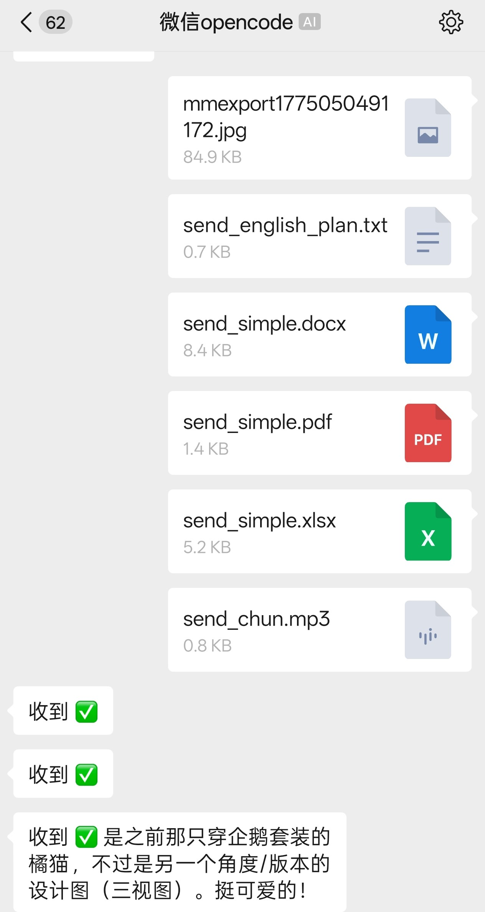
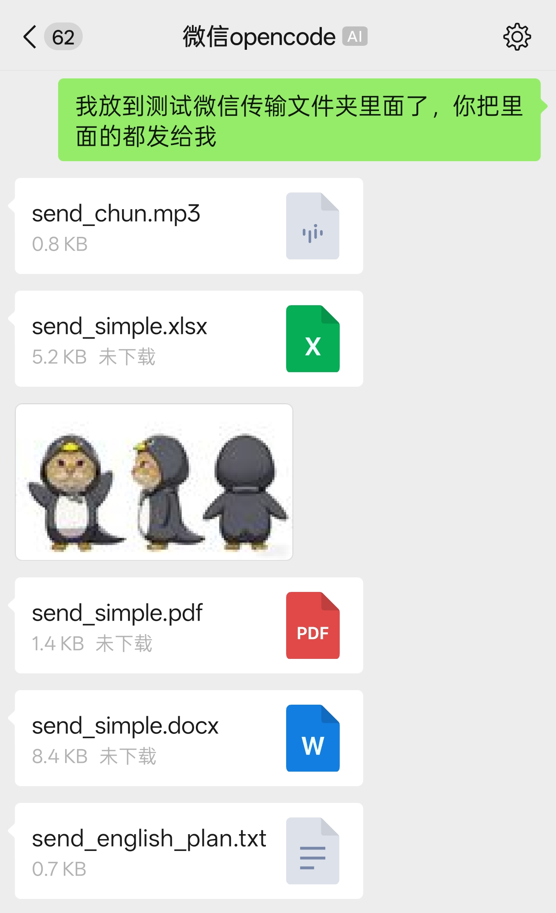

# dsh-wechat

[](https://www.npmjs.com/package/dsh-wechat)
[](https://www.npmjs.com/package/dsh-wechat)
[](https://github.com/pan17/dsh-wechat)

让微信成为 DeepSeek Harness (DSH) 的第二客户端：通过腾讯 iLink bot 协议把
微信私聊桥接到 DSH agent——文本/图片/文件/语音消息双向收发、微信内 slash
命令管理会话/工作区/Preset/模型/权限、审批与提问卡与 GUI 双端同卡同决策、
DSH 设置页内扫码登录与连接配置。以静态 Cordis 插件交付，零运行时
`@deepseek-ai` 依赖，直接调用 DSH 进程内服务。

  

## 功能

- **发送** — 微信文本/图片/文件/语音消息 → DSH agent（媒体自动下载解密到
  `~/.dsh-wechat/tempfile/`，本地路径作为附件注入）
- **打字合并（默认关闭，需显式开启）** — 开启后连续几条微信消息在静默窗口（默认 3 秒）内到达时**合并成一轮**，不再一句话分五段就烧掉五轮；条数上限（默认 10）或上限时间（默认 3 分钟，到点必发）会强制释放。消息末尾 `..` = 还要接着说（暂不发出），`!!` = 立刻提交（两者开启时会被去掉）。**图片/文件不参与合并**：它们会先把已经输入的文字作为一轮发出去，再自己作为一轮进入 agent，顺序不变。微信端 `/merge on|off|status` 切换，设置页同款开关。默认关闭是因为合并改变了「一轮」的含义，且每条消息要多等一个静默窗口——升级后行为与旧版一致，需要时再开
- **接收** — agent 正文独立发送；正文之间的思考与工具调用/结果合并成一条「执行过程」，按桌面端的分组方式阅读。过程在收到下一段正文的第一个有效流式片段时立即推送，正文接收完成后独立发送；提问/审批卡或轮次结束也会发送待发过程；`send_wechat` 工具可主动推送文本/文件到微信
- **微信 slash 命令** — `/workspace`、`/session`、`/preset`、`/model`、
  `/perm`、`/silent`、`/flush`、`/notify`、`/next`、`/status`、`/stop`、`/rq`、
  `/at` 等由 bridge 直接处理（见下方命令表）
- **`@` 引用（`/at`）** — GUI 输入框里的 `@会话` / `@文件` 在微信里的对应物：`/at s <编号|关键词>` 引用其它会话（宿主展开成 `## Referenced sessions` 快照），`/at f <路径>` 引用文件或目录（模型据此 `read`）。微信没有输入框，所以是「先登记、下一条消息自动带上、发一次即清空」；可叠加（会话 ≤3、文件 ≤8），`/at` 查看、`/at rm <编号>`、`/at clear`
- **审批/提问卡（双端同卡）** — 微信与 GUI 弹一致的原生审批/提问卡，
  谁先回复谁生效（原生防双决）
- **微信渠道提示词（动态注入）** — 微信消息注入可配置提示词；GUI 消息时自动消失。设置页可开关/编辑正文，微信 `/surface on|off` 切换
- **静默模式** — `/silent on` 后每轮只发送最终回复，设置页可切换（全局配置，重新扫码后仍保留）。⚠️ 单位是**轮**：一次需求若被拆成多轮（例如目标自动续跑 8 轮），仍会收到 8 条
- **结论模式（只回最终结论）** — 设置页勾选或微信发 `/final on`，跨轮次的中间过程一律暂存，整条任务彻底停下来后**只发一条最终结论**：自动续跑再多轮也只有一条。默认静默 45 秒后交付，最长 10 分钟必发一次；权限卡、提问卡、报错始终立即推送，不受压制；「执行过程」分组直接丢弃；微信发 `/flush` 可随时立即取回。开启后优先于「静默」。配置键 `finalOnly` / `finalOnlyIdleMs` / `finalOnlyCeilingMs`
- **投递可信度** — 错误与摘录先过秘密脱敏（JWT / `sk-` / `gh*_` / `xox*` / `AKIA` / `Bearer` / 长 hex / 长 base64 → `***`，**绝不作用于正常回复正文**）；跨会话完成卡预览取**尾部** 80 字（结论在最后）；长回复按 `（i/n）` 有序分段，代码围栏与表格原子不可切；出站队列满时**强制发出最旧一条**而不是丢弃；`send_wechat` 每分钟限流；`allowedUsers` 白名单可拒绝陌生联系人驱动 bot
- **权限提权只能在本机做** — 微信里的 `/perm default <预设>` 只在**不放宽**权限时写入全局默认；`danger-full-access` 沙箱、或审批策略为 `never` 的预设会被拒绝，并提示到 DSH 设置页操作（全局默认对**所有**新会话生效，与微信无关）。会话级 `/perm switch` 不受影响（非持久）。确需远程改默认时开启 `allowRemotePermissionEscalation`
- **`send_wechat` 不是任意文件读取原语** — 只允许发送**调用会话**工作目录或已注册工作区内的文件（按 `fs.realpath` 归一后比较，`..` 与符号链接都逃不出去），并有字节上限（默认 20 MiB，读取前即拒绝）。要放开任意路径需显式开启 `allowAnyFilePath`
- **入站白名单升级播种** — 老部署升级时若 `state.json` 里**已有绑定用户**且白名单从未配置过，会自动把该用户写入 `allowedUsers`（否则升级后第一个发消息的陌生人就会接管 bot），并在微信里**提示一次**、`/status` 里显示你自己的 user id；全新安装（还没有绑定用户）保持「首个给你发消息的人成为绑定对端」，不会被锁在门外
- **日志与审计** — 入站日志只记**脱敏**后的发送者 id，正文预览再过一次 `maskSecrets`；`~/.dsh-wechat/audit.jsonl` 追加记录入站（脱敏 id + 长度，不含正文）、slash 命令名、`/at` 引用登记（只记 `session`/`file` 类别，不记路径与标题）、审批/提问决定、`send_wechat` 文件路径、每次出站发送结果，按 1 MiB 上限轮转为 `audit.jsonl.1`；`~/.dsh-wechat` 目录 `0700`、其下文件（token/state/config/sync-buf/审计）均为 `0600`
- **出站串行槽可诊断** — 锁内再调用公共入口会**立刻报错**（而不是把自己排到自己后面永久卡死），单次操作挂死时后续发送最多等 30 秒后照常发出并记日志
- **繁忙时投递（与 DSH 同源）** — 按 `busyEnter` 排队/插话；微信 `/enter` 同步
- **跨会话决策推送** — `/notify on` 后，任意会话的权限/提问卡整卡推送到微信。当前会话可直接回；其它会话必须 `P{n}=…`（`P1=/rq` 关闭该卡）。默认关。跨会话任务完成/报错走 `/notify tasks on|off`
- **二维码登录** — `http://127.0.0.1:3080/wechat/qr` 扫码登录，设置页内嵌
- **设置页 UI** — DSH 设置 → **WeChat**：状态区 + 5 个可折叠分组（连接与默认行为 / 消息推送 / 打字合并 / 微信渠道提示词 / 安全边界），默认收起并显示当前值摘要（保存即生效，存储于 `~/.dsh-wechat/config.json` 与 `state.json`）
- **断点续传** — `sync-buf` 与微信会话映射持久化，重启 DSH 后自动恢复会话
- **单用户** — 只服务第一个微信用户；bot token 缺失/失效时不向微信推送，日志会写明原因（需重新扫码或等会话恢复）

## 安装（部署到 DSH profile）

当前版本要求 **DSH `>=0.2.1-0`（且 `<0.3.0-0`）**。这条要求写了两处：`engines.dsh`（供插件市场展示，宿主不读）与 `peerDependencies["@deepseek-ai/dsh"]`（宿主**强制校验**——不匹配会跳过整个插件包）。低于 `0.2.1-0` 或高于 `0.2.x` 的 DSH 会被拒绝加载。

### 方式一：设置页内直接安装（推荐）

打开 **设置 → 插件 → 添加插件**，在输入框填包名：

```text
dsh-wechat
```

点「安装」即可。插件声明了 `dsh.bundle`，安装时会被自动注册成 bundle 层，
不需要再手动改 profile 配置。国内网络下载慢时，把「安装源」切到
**中国大陆镜像源**。

安装完成后若提示「已安装，下次启动后加载」，重启 DSH 即可；若出现
「立即启用」按钮，也可以直接点它免重启。

然后浏览器打开 **设置 → WeChat**：扫码登录、查看状态、改配置，或直接访问
`http://127.0.0.1:3080/wechat/qr` 扫码。

### 方式二：命令行

DSH 自带插件管理命令 `dsh plugin`（在 profile 目录转发 pnpm，并自动把
声明了 `dsh.bundle` 的依赖加入 bundle 层）：

> ⚠️ **别用** `npx dsh plugin`——npm 上 `dsh` 这个名字早在 2016 年就被一个不相关的 JS shell 包占了（`dsh@1.0.1`，作者 `infusion`），它没暴露 CLI bin，会报 `could not determine executable to run`。DSH 的 CLI 在 scoped 包 `@deepseek-ai/dsh` 下，必须用完整名。

桌面版（Electron）用户请直接用应用自带的 `dsh` 命令（安装桌面版时会加入 PATH），
它支持 `--profile desktop`：

```bash
# 安装（自动添加依赖 + 注册 bundle 层）
dsh plugin --profile desktop add dsh-wechat

# 查看已装版本
dsh plugin --profile desktop list --depth 0

# 重启 DSH
```

其他管理命令（同样自动维护 bundle 层）：

```bash
dsh plugin --profile desktop update dsh-wechat   # 升级
dsh plugin --profile desktop remove dsh-wechat   # 卸载（从 bundles 移除）
```

> `--dump-config` 在 `desktop` profile 上会被拒绝（该 profile 由 Electron 应用
> 独占管理），要验证组合配置请改用 `dsh plugin --profile desktop list`，
> 或在设置页查看。
>
> 非桌面版（`web` / `tui` / `headless` 等自建 profile）用 scoped CLI：
>
> ```bash
> npx @deepseek-ai/dsh plugin --profile web add dsh-wechat
> npx @deepseek-ai/dsh --profile web --dump-config   # 应看到 "- id: dsh-wechat" 行
> ```

> 插件从 npm 官方源安装（`dsh plugin add` 即 `pnpm add dsh-wechat`）。
> 修改代码后需**重启 DSH** 才能让改动生效。

## 微信命令

### 与 DSH 原生命令同步

<details>
<summary>点击展开：bridge 如何接入 DSH 的 <code>ctx.commands</code> 注册中心（计划模式 / 目标 / 压缩 等原生 slash 命令走的就是这条路）</summary>

微信消息进入后，bridge **先**向 DSH 的 `ctx.commands` 注册中心查询当前会话
已注册的命令（这是 DSH 内置的人类 slash 命令注册服务，由 `@deepseek-ai/dsh-commands`
提供；`name` /plan、`name` /goal、`name` /compact 等命令都由各自的 bundle 在那里
注册）。命中即直接交给原生 handler 执行，并把结果回执渲染到微信——和 GUI 走同
一条命令管线。

未注册的命令回落到本仓库硬写的本地命令表（`/silent`、`/next`、`/rq`、
/workspace、`/session` 等），命中失败时按 "未知命令" 提示并作为文本转发给 agent。
DSH 的 `ctx.commands` 服务在某些极简装配下可能不挂载（缺失时会打一次 warn），
这种情形行为完全等同之前的版本。

所以：**DSH 加任何新的 `/xxx` 命令 bundle，微信端无需改动即可识别**——只要它是
按 DSH 命令注册契约挂上去的。例如装有 `dsh-plan-mode` 时微信发 `/plan off` 收
到原生回执 "Plan mode off."；装有 `dsh-command-goal` 时 `/goal <目标>` 收到原生
"Goal created ..."；装有 `dsh-command-compact` 时 `/compact` 收到 "Compacted N
history items (~M tokens)."——与 GUI 同款回执，由原生 handler 自己算、自己发。

`/help` 在末尾加一段 `── DSH 原生命令（当前 profile 已注册）──`，列出当前
profile 实际注册的所有原生命令；本地命令表里已有的名字自动去重，不会重复
出现。

</details>

### 本地命令表

| 命令 | 说明 |
|---|---|
| `/help`（`/h`、`/?`） | 帮助 |
| `/status` | 当前状态：工作区、会话、Agent、待处理(当前)/待处理(跨会话)、当前会话 Preset、模型、上下文、权限、默认 Preset、静默、结论模式、繁忙投递、跨会话决策推送、跨会话任务完成提醒；末尾追加 DSH 通过 `ctx.sessionProjections` 注册的所有会话级状态，分四段显示——`[模式]`（plan / goal / subagent / todos）、`[用量与统计]`（tokenUsage / contextPressure / contextBreakdown / sessionStats / subagentTiming）、`[会话]`（title / sessionListMetadata / permissions / imageLimits）、`[其它]`（未识别 key 自动归类）；DSH 加新 plugin 自动出现 |
| `/workspace (ws) — list [all\|数量] \| status \| switch <编号\|路径> \| add <路径>` | 工作区管理（list 默认显示 20 个、按添加顺序（新加的排最前），`all` 或显式数量看更多；显示各工作区会话数，不含已归档；switch/add 回复会写明恢复的会话名字和完整 id，跳过已归档；该目录无可见会话时提示发送消息将创建） |
| `/session (s) — list [current] [all\|数量] \| switch [current] <编号> \| pin [编号] \| unpin [编号] \| new \| status` | 会话管理（list 默认显示最近 20 个，`all` 或显式数量看更多，标记当前，不显示 GUI 已归档会话；**置顶会话排在列表最前并标 `📌`**，`pin`/`unpin` 省略编号时作用于当前会话，带编号时按 `/s list` 的行号解析；`list current` 只看当前工作目录——cwd 按宿主 `fs.promises.realpath` 规则归一（尾斜杠/`..`/大小写差异都能匹配），推荐用 `switch current <编号>` 按同一列表切换；紧接着直接 `switch <编号>` 也会复用最近一次列表编号；普通无列表上下文时 `switch <编号>` 对应全量列表；switch 回复同时带会话名字和完整 id；`new` 复用当前工作区空白会话，与 GUI「新建会话」同款，无空白才新建） |
| `/preset (p) — list \| switch <名称\|编号> \| status` | 默认 Preset（写入 DSH 设置，与 GUI 同步；`status` 看全局默认，不是当前会话；当前会话无内容时 `switch` 立即应用） |
| `/model — list [提供商] \| switch <提供商/模型> \| status` | 模型管理（切换立即作用于当前会话 + 设为默认；当前推理等级若新模型支持则一并保留，否则清空） |
| `/perm — status \| list \| switch <名称\|编号> \| default [名称\|编号]` | 权限管理（switch 实时切当前会话；default 写 DSH 设置，新会话生效） |
| `/reasoning — [list \| default \| switch <等级>]` | 推理等级：查看当前/默认与模型支持的等级；`switch <等级>` 切换（实时 + 写默认）；`default` 恢复模型默认 |
| `/enter queue\|steer\|status`（`/busy`） | 繁忙时投递：agent 运行中收到微信消息时排队（`queue`）还是插话进当前轮次（`steer`）；读写 DSH 设置 `ui-conversation.busyEnter`，与 GUI「繁忙时 Enter 键行为」同源同步；空闲会话始终新开一轮 |
| `/silent on\|off`（`/sl`） | 静默模式：开启后仅在轮次结束发送最后一条助手正文；关闭后思考与工具合并为「执行过程」，正文独立发送；写入 `config.json`，重新扫码后仍保留，设置页可切换。⚠️ 单位是「轮」——一次需求若被拆成多轮（例如目标自动续跑 8 轮），仍会收到 8 条；要按「任务」只收一条请用结论模式（`/final on`） |
| `/final on\|off\|status`（`/fo`） | 结论模式开关：开启后跨轮次暂存，整条任务停下后只发一条最终结论（优先于 `/silent`）；`off` 会把**当前暂存的内容先交付**再关闭（暂存是 agent 已经产出的结论，关掉不该把它销毁）；`status` 显示模式与暂存条数。写入 `config.json`，重新扫码后仍保留，与设置页「结论模式」同一个值。⚠️ `/f` 是 `/flush` 的别名，**不是** `/final` 的 |
| `/merge on\|off\|status`（`/mg`） | 打字合并开关：**默认关闭**，开启后连续几条微信消息在静默窗口（默认 3 秒）内合并成一轮；`status` 显示窗口/上限/强制放行/当前暂存条数。消息末尾 `..` 表示还要接着说（暂不发出），`!!` 表示立刻提交（开启时两个后缀都会从正文去掉；整条消息只有后缀且没有待合并内容时按普通文本处理）。达到条数上限、`!!`、或强制放行上限（默认 3 分钟，图片/文件到达也会先冲刷）时一定发出；乱序的旧消息**不会**延长窗口。`off` 会先把暂存的消息作为一轮发出去再关闭（那是你自己说的话，不该被开关吞掉）。写入 `config.json`，重新扫码后仍保留，与设置页「打字合并」同一个值 |
| `/flush`（`/f`） | 立即取回结论模式暂存的最终结论，不必等静默期；没有暂存内容时提示为空 |
| `/surface on\|off\|status`（`/wxprompt`） | 微信渠道提示词注入开关（默认关）；正文在设置页编辑，不在微信改 |
| `/notify on\|off\|status`（`/watch`） | 跨会话决策推送总闸（开：任意会话权限/提问卡整卡推送并可直接回复；关：只答当前会话），默认关闭；`/notify tasks on\|off` 单独开关跨会话任务完成/报错提醒（设置页可切换） |
| `/history [all] [数量]` | 查看最近历史（默认 5 条，最多 20 条；默认只看你和助手，`all` 含压缩检查点/插件注入等系统消息）；当前可回答的提问/权限卡会完整重发（决策推送开启时含其它会话） |
| `/at — [s <编号\|关键词> \| f <路径> \| rm <编号> \| clear]` | 引用其它会话或文件，**附加到下一条消息**（微信没有输入框，无法像 GUI 那样在光标处插 chip，所以改成「先登记、下一条自动带上」）：`/at s 2` 引用 `/s list` 第 2 行的会话（也可用标题/cwd/id 关键词：优先走宿主 `sessionReferenceResolver.listCandidates`，没有 live agent 时退回扫 `/s list` 行；多命中会列出候选让你指定），`/at f src/index.ts` 引用文件或目录（相对当前工作区，或绝对路径如 `C:\Users\me\Desktop\a.txt`；含空格会自动写成 `@"a b.txt"`，也可直接 `/at f "a b.txt"`）；`/at` 查看暂存、`/at rm <编号>` 移除、`/at clear` 清空。上限：**会话 3 个**（宿主 `dsh-session-reference` 单条消息最多 3 个，超了会整轮失败）、文件 8 个；暂存 **10 分钟**有效，**发送一次即消费**。引用块**跟在你的正文之后**（`总结一下这个会话 @Alpha`），因为宿主用消息的**开头**生成会话标题，前置的 base64 mention 会变成新会话的标题。会话引用由宿主展开成 `## Referenced sessions` 快照（与 GUI 的 `@会话` 同一条链路），文件引用是 `@路径` 文本，由 `dsh-file-reference-local` 的提示词让模型用 `read` 去看 |
| `/stop` | 中断当前任务 |
| `/next` | 继续发送因微信限制被缓存的消息 |
| `/rq` | 关闭当前会话的待处理卡（提问+权限）；其它会话用 `P1=/rq` |

其他 `/xxx` 命令作为文本转发给 agent；审批/提问卡双端同弹，已在其他端
处理的卡会提示。

在微信里回答卡片后会收到回执：`✅ 已允许权限卡 P{n}（工具名）。`、
`⛔ 已拒绝权限卡 P{n}（工具名）。`、`✅ 已回复提问卡 P{n}。`——`P{n}` 就是卡片上印的编号，一次 `P1=1 P2=2` 会各回一条。回执是对你自己刚做的动作的确认，**不受** `/notify` 两个开关与静默模式影响。来自其他会话的卡片在正文里标 `❗来自其他会话`。

所有命令均直接映射 DSH 原生服务（`workspaceRegistry` / `sessionQuery` /
`agentPresets` / `agentDefaultModel` / `permissionPresets`），默认值与 GUI
设置页同源同步。

## 架构

```
微信 (iLink) ── long-poll getupdates ──► dsh-wechat (Cordis host plugin)
    ▲                                      │
    │ ◄── sendText/sendMedia ──────────────┤
    │                                      ▼
    │                          DSH 进程内服务（零 @deepseek-ai 运行时依赖）
    │        agents.create/resume ── agent.followup（消息入）
    │        session/event ── assistant/message、turn/end（消息出）
    │        approval/request · user-questions/request waterfall ── 审批/提问卡（镜像 GUI，谁先答谁生效）
    │        tools.register ── send_wechat 工具
```

> 设计说明：微信端是 GUI 的**第二客户端**，功能不多也不少。

## 设置页（DSH 设置 → WeChat）

客户端半部通过 `dsh.client` + `exports["./client"]` 声明（与 dsh-mcp-manager
同款交付），挂载到 `settings.section` slot（nav 顺序 40）：

- **状态区** — 登录阶段（未登录/等待扫码/已扫码，待确认/已登录/登录失败）、Bot ID、
  监控运行状态、已绑定用户数；未登录时直接显示二维码，扫码确认后自动进入已登录；
  同一区放 `重新扫码`（清除 token 重新登录）与 `退出登录`
- **可折叠分组** — 设置按用途分成 5 组，**默认全部收起**，收起时右侧显示由当前配置
  实时算出的摘要（例如「打字合并：已关闭 · 每条消息各自一轮」），展开才编辑：

  | 分组 | 包含 |
  |---|---|
  | 连接与默认行为 | `cwd` / `cardTimeoutMs` / `sendWechatRateLimitPerMinute` / `allowedUsers` |
  | 消息推送 | `跨会话决策推送` / `跨会话任务完成提醒` / `静默` / `结论模式` |
  | 打字合并 | `打字合并` 总开关 + `mergeSilenceMs` / `mergeMaxMsgs` / `mergeForcedReleaseMs` / `合并后缀 .. 与 !!`（总开关关闭时参数置灰，但值仍随保存提交，不会丢配置） |
  | 微信渠道提示词 | `surfacePromptEnabled` + 提示词正文 |
  | 安全边界 | `allowRemotePermissionEscalation` / `allowAnyFilePath` / `maxOutgoingFileBytes` |

  展开状态记在浏览器 localStorage（`dsh-wechat/settings-open`），不进 `config.json`；
  存储不可用时退化为「能展开但不记忆」，不会报错。
- **保存** — 底部 `保存配置` 一次提交全部字段；有改动未保存时按钮旁显示
  `● 有未保存的修改`。`baseUrl` / `cdnBaseUrl` / `botType` / `textChunkLimit` /
  `finalOnlyIdleMs` / `finalOnlyCeilingMs` 仍可写 `~/.dsh-wechat/config.json` 或插件行
  `config:`，设置页保存不会覆盖它们。网关参数变更会自动重启长轮询；存储于
  `~/.dsh-wechat/config.json` 与 `state.json`
- **帮助** — 卡片标题行的 **指令帮助** 按钮展开本地命令表（与微信 `/help` 同源）；
  DSH 原生命令仍只在微信 `/help` 末尾按当前 profile 列出
- **已知限制** — 页面底部的告警盒，同样可折叠（默认收起），列出 iLink 的 10 条窗口
  与 24 小时互动窗口

与宿主通信走插件自己的 HTTP API（`/wechat/api/status|help|config|relogin|
logout`），客户端零 `@deepseek-ai` 依赖。

## 配置

优先级：内置默认 ← 插件行 `config:` ← `~/.dsh-wechat/config.json`
（设置页写入，覆盖前两者）。插件行可带 `config:`：

```yaml
# 例：追加到 profile 的 cordis.patch.yml
- id: dsh-wechat
  config:
    cwd: 'C:\projects\my-project'
```

| 键 | 默认值 | 说明 |
|---|---|---|
| `baseUrl` | `https://ilinkai.weixin.qq.com` | iLink 网关 |
| `cdnBaseUrl` | `https://novac2c.cdn.weixin.qq.com/c2c` | 媒体 CDN |
| `botType` | `"3"` | iLink bot 类型 |
| `storageDir` | `~/.dsh-wechat` | token/sync-buf/会话映射/临时文件 |
| `cwd` | `process.cwd()` | 新会话工作目录 |
| `textChunkLimit` | `4000` | 微信单条消息长度上限 |
| `cardTimeoutMs` | `1800000` | 提问/权限卡软超时（30 分钟） |
| `crossSessionNotify` | `false` | 跨会话决策推送总闸（任意会话的权限/提问卡整卡推送，微信直接回复） |
| `notifyTaskEvents` | `false` | 跨会话任务完成/报错提醒（独立于决策推送，默认关） |
| `silent` | `false` | 静默模式总闸（只发**每轮**最终回复；重新扫码后仍保留） |
| `finalOnly` | `false` | 结论模式总闸（跨轮次暂存，整条任务停下后只发**一条**最终结论；优先于 `silent`） |
| `finalOnlyIdleMs` | `45000` | 结论模式静默期：任一活动事件（助手正文、轮次结束、`agent/status` 空闲/运行）都会把它重新推后 |
| `finalOnlyCeilingMs` | `600000` | 结论模式硬顶：从第一次暂存起算，到时无论是否仍在续跑都强制交付一次（10 分钟） |
| `sendWechatRateLimitPerMinute` | `10` | `send_wechat` 工具每分钟推送上限（滑动 60 秒窗口；`0` = 不限）。超限时工具**明确返回失败**并告知模型，而不是继续刷用户 |
| `allowedUsers` | `[]` | 入站白名单（微信 user id 数组）。**空 = 现有行为**：首个入站者成为绑定对端；非空 = 只有名单内的 id 会被处理，其余在去重/预算/建会话/命令分发之前拦下并记日志，绝不回复。**升级播种**：`config.json` 里从未写过该键、且 `state.json` 已有绑定用户时，启动会把该用户写入这里并持久化（微信里提示一次，`/status` 显示你的 id）；显式存过 `[]` 则永不覆盖 |
| `allowRemotePermissionEscalation` | `false` | 是否允许微信 `/perm default` 放宽**全局**默认权限。关闭时：解析出的沙箱为 `danger-full-access` 或审批为 `never` 的预设被拒绝并提示到 DSH 设置页操作；不放宽的写入仍允许；会话级 `/perm switch` 不受影响 |
| `allowAnyFilePath` | `false` | 是否允许 `send_wechat` 发送任意路径的文件。关闭时只允许**调用会话**工作目录或已注册工作区内的文件（`fs.realpath` 归一后比较，`..`/符号链接逃不出去） |
| `maxOutgoingFileBytes` | `20971520` | `send_wechat` 发送文件的字节上限（20 MiB）。超限在 `stat` 阶段即拒绝，不会读进内存；缓存队列里的文件在冲刷时也会重新校验 |
| `mergeEnabled` | `false` | **打字合并总闸（默认关闭）**：开启后连续几条微信消息合并成一轮。`/merge on\|off` 与设置页同款；关闭时每条消息各自一轮 |
| `mergeSilenceMs` | `3000` | 合并静默窗口（毫秒）：窗口内到达的消息继续追加；`0` = 关闭窗口（等同关闭合并）。乱序更旧的消息不会延长窗口 |
| `mergeMaxMsgs` | `10` | 单批消息条数硬上限：达到即立刻合并发出（防御性上限，永不超过） |
| `mergeSuffixTokens` | `true` | 是否识别正文末尾的 `..`（继续追加）与 `!!`（立刻提交）；开启时后缀会从正文中去掉 |
| `mergeForcedReleaseMs` | `180000` | 强制放行上限（毫秒，3 分钟）：无论窗口、`..` 暂挂、还是上一批仍在投递，到点一定发出——「宁可两句话一轮，也不让通道卡死」 |
| `surfacePromptEnabled` | `false` | 微信渠道提示词总闸（微信消息驱动时注入，GUI 消息时仍隐藏） |
| `surfacePrompt` | 见默认中文 | 注入正文（设置页编辑；含 `{{` 会被打散以免打断 DSH interpolate） |

## 开发

```bash
npm install
npm run build    # tsc → dist/
npm test         # vitest（splitText/出站 Markdown 过滤/解析/帧处理/waterfall 竞速/状态存储/命令解析/超时恢复/状态颜色/历史截断/渠道提示词/结论模式/打字合并/脱敏/限流与白名单/权限提权闸门/send_wechat 文件边界/白名单播种/审计与文件权限/出站串行槽/有界缓存/dispose 语义/驱动宿主版本区间/DSH >=0.2.1-0 适配）
```

⚠️ **CI 跑在 Linux（`ubuntu-latest`）上，所以 Windows 上"全绿"不等于 CI 绿。** 已经踩过一次：一条断言把 Windows 形状的字面量 `C:\home\.dsh` 同时当输入和期望前缀，而实现会先对该根目录做 `path.resolve`——在 POSIX 上那是**相对路径**，会解析到 cwd 之下，于是 `built.startsWith("C:\home\.dsh/sessions")` 恒为 false，本地 Windows 必绿、CI 必红。

改动测试（尤其涉及路径/权限/文件系统的用例）后，请在 Linux 上再跑一遍完整 CI 步骤：

```bash
bash scripts/ci-local.sh    # Linux / macOS / Windows 的 WSL 里都可用
```

它把检出复制到本机临时目录再 `npm ci && tsc --noEmit && vitest run`（与 CI 完全一致），因此不会用 Linux 版的 esbuild/rollup 覆盖你工作副本里的 `node_modules`。

当前版本针对 **DeepSeek Harness `>=0.2.1-0 <0.3.0-0`** 的宿主 API；仓库本身不依赖任何 `@deepseek-ai/dsh-*` 运行时包（`peerDependencies` 里的 `@deepseek-ai/dsh` 是**宿主契约声明**，不是依赖，并已标 `optional` 以免安装时把整个 harness 拖进 profile）。宿主版本要求写了两处、值完全一致：

- `engines.dsh` —— **声明性**。宿主 `evaluatePluginCompatibility` 只校验 `peerDependencies`，**没有任何代码读 `engines`**；真正读它的是插件市场 `dshmarket`（顶层 `engines.dsh` 优先于嵌套 `dsh.engines.dsh`），且固定以 `{ includePrerelease: true }` 求值。
- `peerDependencies["@deepseek-ai/dsh"]` —— **强制**。不匹配时宿主会**跳过整个 `dsh-wechat` bundle**（`profile.ts` 抛错 → `skippedBundles`，并在每次启动时向 stderr 写一行 `skipping profile bundle`），插件在桌面端表现为消失。
  - 该 peer 必须同时标 `peerDependenciesMeta.optional`。实测（`pnpm pack` 后 tarball 安装）：不加 `optional` 会**安装失败**（`exit=1`）——peer 被当成真实依赖解析，`@deepseek-ai/dsh` 元包带 82 条 dependencies，会拉进 530 个包并撞上未发布包 `@deepseek-ai/dsh-type-meta` 的 npm 404；即使能解析，lockfile 也会从 28 行膨胀到 8199 行。加 `optional` 后 `exit=0`、lockfile 28 行。宿主门禁**不读** `peerDependenciesMeta`，所以强制力不受影响。

范围只有一段 arm，因为前发布元组枚举并无必要：唯一消费者在 `includePrerelease` 语义下求值，一条 `>=0.2.1-0 <0.3.0-0` 已放行全部 0.2.x 前发布版；而枚举永远补不全（每来一个新的 0.2.x 元组都得再加一条）。上界必须写成 `<0.3.0-0` 而非 `<0.3.0`——后者在 `includePrerelease` 下会放行 `0.3.0-rc.1`。`tests/host-line.test.ts` 用真实 `semver` 把这张准入/拒绝矩阵与两处声明的一致性钉死。

> **与生态另一种写法的对比**：`@anysearch/anysearch-dsh` 不写 `engines.dsh`，而是对**具体子包**声明 `peerDependencies`（`@deepseek-ai/dsh-tools`、`@deepseek-ai/dsh-web` 等）且大多用 `"*"`，其 `docs/dsh-compatibility.md` 明确说这是「默认放行新 DSH 版本、矩阵只记录已验证版本而非安装白名单」。两者取舍不同：`"*"` 换来「新宿主版本无需改 manifest」，代价是**放弃版本防护**（`*` 连 `99.0.0` 都放行）；本仓选择精确区间，代价是 DSH 大版本升级时要主动更新声明。注意 anysearch 那套用 `"*"` 无法照搬到一个元包 peer 上——`@deepseek-ai/dsh` 是聚合包，解析它就会拉整棵依赖树。

## 已知边界

- `/s list` 与 `/workspace list` 默认各显示 20 行，行末会提示「显示 20/N，看更多: … all（或 … <数量>）」；`all` 不设上限。会话或工作区很多时，回复会按 `textChunkLimit`（4000 字）拆成多条消息，超出微信 10 条/窗口额度的部分进入 `/next` FIFO 缓存（上限 100 条），需在微信端主动发消息或发 `/next` 继续发送。
- `/s list` 的编号与显示窗口无关：`/s switch <编号>` 仍按**完整**列表校验，所以 `/s list` 之后 `/s switch 25` 能切到未显示的第 25 条（列表行号 1-20 与它一一对应，靠「看更多」提示按需展开）。
- 会话置顶走宿主注册表（`workspaceRegistry.pinnedSessionIds` / `pinSession` / `unpinSession`），与 GUI 侧边栏共享同一份**持久**集合，任一端置顶或取消，另一端立即一致；`/s pin` / `/s unpin` 只写这一处，不额外落本地状态。置顶区内部仍按最近活动时间降序（对应 GUI 的「最近更新」视图——置顶时间不参与排序），所以置顶只改变分区归属，不冻结行内顺序；无置顶时行序与以前完全一致。归档与置顶互斥：已归档会话无法置顶（GUI 归档时会顺带清掉该会话的置顶），`/s list` 也不显示归档会话，因此只有「当前绑定会话」这条路径可能撞上该限制。宿主未挂载 `workspaceRegistry` 或版本早于该功能时，置顶命令提示「未提供置顶服务」并降级为无置顶显示，不会报错。
- `list current` 的目录匹配走宿主的 canonical path 规则（`fs.promises.realpath`，与 `@deepseek-ai/dsh-workspace` 的 `realpathNormalize` 同源）：折叠尾斜杠、`.`/`..`、混合分隔符、符号链接，Windows 上也折叠大小写——与 GUI 侧边栏的工作区分组完全一致。目录已删除/无法解析时退化为 `path.resolve` 归一。`/s new` 复用空白会话、`/workspace list` 的「◀ 当前」标记、以及跨会话任务提醒的收件人解析都用同一套比较。
- 出站文本按官方微信渠道（[Tencent/openclaw-weixin](https://github.com/Tencent/openclaw-weixin)）的 `StreamingMarkdownFilter` 处理，而不是一律剥掉 Markdown：`**粗体**`、链接、H1–H4 标题、代码块（```）、行内代码、引用（`>`）、分隔线（`---`）与表格都原样发送；只去掉微信不渲染的部分——图片（`` 整段移除）、H5/H6 标题标记，以及包裹中文的单个 `*`/`_`/`***`/`___` 强调标记（内容保留）。
- 微信「执行过程」是单条普通文本消息，没有桌面端的折叠交互。内容采用桌面端收起条目的规则：思考首行、中文工具标题与路径/描述，成功输出隐藏、失败仅一行错误、任务清单显示完成计数与变更；长分组标明省略数量，可在 DSH 查看完整记录。过程仅覆盖当前绑定会话，静默时隐藏；**结论模式下直接丢弃**（否则每轮仍会推一条过程消息，正是该模式要消除的洪水）；已推送过程与正文共享发送额度，超限走 `/next`。未推送的过程分组不跨进程重启保存。
- 结论模式（`finalOnly`）按**任务**而非轮次收敛：暂存的是「这条任务最终那一段正文」，因此**中间轮次的正文与「执行过程」都不会到达微信**，交付时若跨了多轮会在首行标注 `✅ 已完成（共 N 轮）`。它不改变 agent 的行为，只改变推送时机；等待期间随时可发 `/flush` 取回，发下一条需求也会先交付上一件事的结论。微信端用 `/final on|off|status` 开关（与设置页同一个值），`/final off` 会先交付暂存再关闭。硬顶存在的原因是「宁可晚一点，也不能永远沉默」。暂存只在内存里，插件 dispose 会冲刷交付、登出/换绑会丢弃。
- 秘密脱敏（`maskSecrets`）作用范围刻意只限**错误文本与摘录**：`32+ hex` 与 `40+ base64` 两条规则会误伤 commit SHA、长 id 与长路径，所以绝不用于 agent 的正常回复正文。这是有意的取舍，`tests/redact.test.ts` 用两条断言把这个误伤边界固定下来，而不是假装它不存在。
- `（i/n）` 分段按**码点**计预算、前缀长度计入预算，代码围栏与 GFM 表格原子不可切；唯一允许超长的例外是「最小合法形式本身就超过预算」的构造（围栏分隔符、或表头+分隔行+首行），此时宁可超长也不产出残缺的 Markdown。
- `allowedUsers` 为空时是**现有行为**（首个给你发消息的人成为绑定对端），不是「拒绝所有人」——这样老部署升级后不会突然失联；要收紧就填名单，未列出的 id 会在去重/建会话/命令分发之前被拦下并记日志，绝不会得到回复。⚠️ **升级播种会改变这一状态**：`config.json` 里从未配置过该键、而 `state.json` 已有绑定用户时，启动会把该绑定用户写进名单（并在微信里提示一次）——这正是为了堵住「升级后第一个陌生人接管 bot」，但也意味着升级后**其他人**发消息会被忽略；要放开就在设置页清空该字段（显式存过 `[]` 后不会被再次播种）。
- 打字合并（`mergeEnabled`）**默认关闭**：每条微信消息各自一轮，与旧版行为一致。开启后（`/merge on` 或设置页）窗口内的多条会合并成一轮，代价是每条消息多等一个静默窗口；它对语义的影响是「一轮里可能包含多条用户消息」，需要每条消息单独成轮时保持关闭或发 `/merge off`。图片/文件类消息**不参与合并**（先冲刷已输入的文字，再自己作为一轮），因此一次「文字 + 图片」仍会产生两轮；`..` 暂挂的批次仍受条数上限与 3 分钟强制放行约束，不会无限期等下去。
- 记忆表有界：跨会话完成卡的正文预览（每会话一条，上限 64 个会话）、`/s list` 的最近活动时间（上限 512 个会话）、`/model` 覆盖（上限 128 个会话）、微信消息来源标记（上限 512 条 / 10 分钟 TTL）都是**缓存**——被淘汰只会让该行退回默认显示（创建时间、部署默认模型、按会话 id 显示标题），不会丢失队列里的任何消息。出站队列的内存边界仍是硬上限 400 条（`MAX_OUTBOUND_QUEUE_HARD`），重启后**完整**恢复（此前只恢复最后 100 条，第 101–400 条会被静默丢弃）。
- 打字合并的缓冲区**不因 slash 命令而提前释放**：`/status`、`/next` 等命令照常立即执行，缓冲的文本仍由静默窗口 / 条数上限 / 强制放行三者之一释放（因此不会丢，只是可能晚几秒）。插件 dispose 会先把缓冲区投递再注销交互；登出 / 重新扫码 / 换绑则**丢弃**（身份变了，别人说的话不该发给下一个绑定者）。
- `/at` 是**暂存式**：命令本身不改写当前消息，引用落在**下一条**投递给 agent 的消息上（打字合并开启时落在合并后的那一批），投递成功即清空；agent 创建/恢复失败时**不清空**，重发正文即可。暂存只在内存里（不写 `state.json`）：插件重启后失效——一条引用是「这一次」的意图，重启后大概率已不是同一件事，复活它只会把无关上下文塞进新的一轮。`/at` 命令本身不冲刷打字合并缓冲区（与 `/status` 等一致）。会话引用依赖宿主挂载 `dsh-session-reference`，未挂载时明确拒绝（否则 mention 会被当成普通文本转发，模型只看到一个 base64 串）；文件引用只是 `@路径` 文本，不需要任何服务即可生效，**不受工作区限制**：`@文件` 是交给模型的指针，不是 bridge 自己去读内容，宿主 `FILE_REFERENCE_PROMPT` 明确写了「绝对路径指代宿主机上的文件或目录」，能不能打开由 agent 自己的沙箱策略决定——这与 `send_wechat`（bridge 亲自读字节发出去）是两条不同的边界。路径两端的不可见格式字符（从资源管理器/浏览器复制路径常带 U+202A 等）会自动剥掉，中文输入法打出的弯引号 `“…”` 也接受。⚠️ 会话引用在**发送时**由宿主读取：若被引用的会话在这 10 分钟内被删除，宿主会以 `SESSION_REFERENCE_READ_FAILED` 终止该轮——这是宿主语义，微信端只能在 `/at` 阶段挡住「引用自己 / 超过 3 个 / 服务缺失」这三类可预见的失败。
- `~/.dsh-wechat` 与其下文件（`auth/token.json`、`state.json`、`config.json`、`sync-buf.json`、`audit.jsonl`）以 `0700` / `0600` 创建。⚠️ **Windows 上 Node 忽略 mode 参数**（`chmod` 只能切只读位），实际保护来自 `%USERPROFILE%` 继承的 ACL（仅本人、`SYSTEM`、`Administrators` 可读）——这是依赖继承 ACL，不是本插件自己设的权限。审计文件按 1 MiB 轮转为 `audit.jsonl.1`（只保留一份历史），轮转会记一行日志。
- 审批/提问卡挂在 Host 的 `approval/request` 与 `user-questions/request`
  waterfall 上，与 GUI 竞速；无微信 peer 时立即 `next()`，软超时只撤微信卡、不替用户决策。微信先答时会 abort 传给 GUI 的 `request.signal`（不碰 turn 的 `exec.signal`），Web composer 卡随 Gateway `cancel` 帧收起。DSH 重启后未决卡片随 turn 消失（上游已知限制）。
- 微信回答卡片后的回执**每条占一次微信发送额度**（10 条/窗口）。一次 `P1=1 P2=2` 会发 2 条回执；额度用尽时回执与其他出站消息一样进入 `/next` FIFO 缓存，不会被丢弃。`P{n}` 是整批处理开始时快照的编号（卡片在结算时即被摘除，现算取不到编号、回执会退化成不带编号的文案）。跨会话卡的 `❗来自其他会话` 只是正文提示标记，不影响编号或回复语法。
- `send_wechat` 工具对所有 agent 可见；任何会话的 agent 都能调用——绑定会话发送到绑定用户，未绑定会话回退到首个已知微信用户（单用户部署默认行为）。
  单用户模式下，工具推送与 assistant 回复共享唯一一份微信 10 条/窗口限流预算：超限或发送失败自动进入 `/next` FIFO 缓存队列。计数和队列持久化到 `state.json`，普通 DSH 更新或重启后继续沿用；下一条微信入站会重置窗口并自动补发。微信真实限流响应（HTTP 200 + `ret: -2` / `prepare failed`）也会被识别并缓存，不再误判成功。
- `/preset switch` 遵循 DSH 约束：只有未产生任何内容的会话才能当场
  `recompose`；已有内容的会话会提示 Preset 应用于下一个新会话。默认
  Preset 本身写入 DSH 设置文档——按设置服务公布的命名空间写入
  `agent-preset-registry.selectedDefault`（保留旧版 `agent-presets.default`
  回退），GUI 设置页与微信双端读写同一事实源；写入被拒绝时明确提示
  「默认 Preset 切换失败，默认 Preset 未更改」，不再误报成功。
- 入站重投按微信用户 + 服务端 `message_id`（缺失时用有效 `seq`）去重，缓存保留 30 分钟、最多 4096 条，作用于当前插件实例；重连保留缓存，退出登录/重新扫码清空。无有效身份的消息放行，相同文本但不同身份的消息正常处理。去重缓存不跨进程重启持久化，也不协调同时配置的多个插件实例。
- 同一用户的会话检查与创建串行执行，避免首次收消息或工作区无绑定时并发创建多个会话。停止/重连会取消正在进行的长轮询，丢弃旧轮询迟到的消息；重连等待旧轮询退出后启动新轮询。
- iLink 通道是腾讯官方 bot 协议，接口可能随官方调整；跟随 wechat-opencode
  上游的 `src/weixin/` 修复即可。

## 许可

MIT。`src/weixin/`、`src/adapter/` 移植自
[wechat-opencode](https://github.com/pan17/wechat-opencode)（MIT，
原始来源 `@tencent-weixin/openclaw-weixin`），文件头保留出处注释。

## 免责声明

本项目与 DeepSeek Harness、腾讯微信官方**互不隶属**，非官方项目，
纯属个人学习用途。使用本项目即表示你自行承担由此产生的一切后果。
