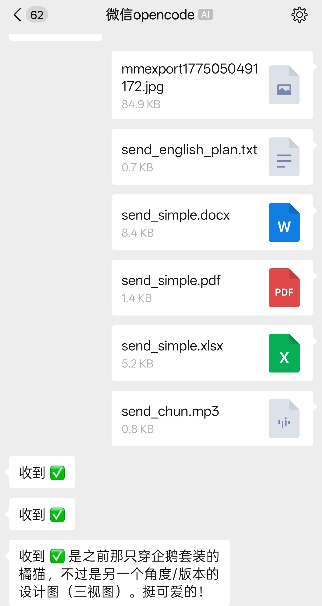
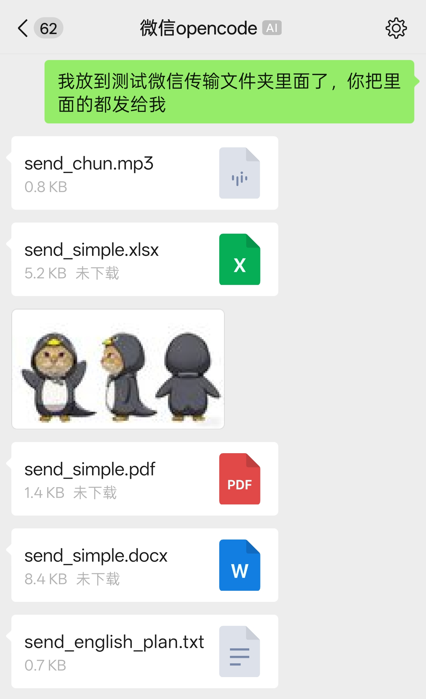
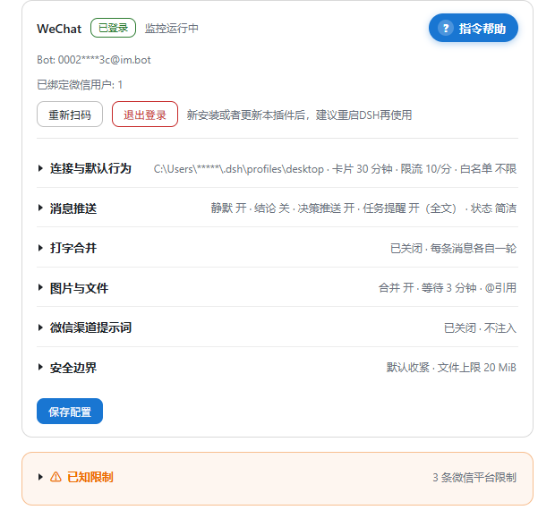

# dsh-wechat

[](https://www.npmjs.com/package/dsh-wechat)
[](https://www.npmjs.com/package/dsh-wechat)
[](https://github.com/pan17/dsh-wechat)

把微信变成 [DeepSeek Harness](https://github.com/deepseek-ai/deepseek-harness) (DSH) 的第二客户端：在微信里和你的 agent 聊天，文字、图片、文件和语音双向传输，用 slash 命令管理会话、工作区、模型、权限等等。

  

## 安装

要求 DSH `>=0.2.1-0 <0.3.0-0`。

**方式一：设置页**（推荐）— 打开 **设置 → 插件 → 添加插件**，填 `dsh-wechat`，点安装，然后重启 DSH。国内网络慢时把安装源切到**中国大陆镜像源**。

**方式二：命令行**（桌面版）

```bash
dsh plugin --profile desktop add dsh-wechat
dsh plugin --profile desktop list --depth 0    # 查看已装版本
```

安装后打开 **设置 → WeChat** 扫码登录。接入第二个微信时，点「添加账号」，用第二个微信扫码确认。选中账号后，可以设置备注名和工作目录。每个账号独立收发消息，主动推送可按备注名指定一个或多个接收账号。

**从单账号版升级**：原版默认保存在 `~/.dsh-wechat/` 的登录信息、配置和会话绑定需要重新设置。升级后请重新扫码，按需用 `/s list` 和 `/s switch <编号>` 接回原来的 DSH 对话。旧目录和 DSH 聊天记录会保留。

## 微信命令

| 命令 | 说明 |
|---|---|
| `/help`（`/h`、`/?`） | 命令一览，含当前 profile 已注册的 DSH 原生命令 |
| `/help <命令>` | 该命令的全部例子，如 `/help s`、`/help merge` |
| `/status` | 工作区、会话、模型、权限、各开关状态；末尾会话级状态默认只显示模式和后台任务（`/status full` 看全部） |
| `/workspace`（`/ws`） | `list` / `status` / `switch <编号\|路径>` / `add <路径>` |
| `/session`（`/s`） | `list [current]` / `switch [current]` / `pin` / `unpin` / `new` / `status` |
| `/fork` | `list [all\|数量]` 看每轮提问与最终回复，`show <编号>` 看全文，`switch <编号>` 从那轮分叉新会话 |
| `/preset`（`/p`） | `list` / `switch <名称\|编号>` 切当前会话（第一条消息前）/ `default [名称\|编号]` 改新会话默认 / `status` |
| `/model` | `list` / `switch <提供商/模型>` / `status` |
| `/perm` | `status` / `list` / `switch <名称\|编号>` / `default [名称\|编号]` |
| `/reasoning` | 查看或切换推理等级 |
| `/enter`（`/busy`） | 繁忙时 `queue` 排队还是 `steer` 插话 |
| `/steps [极简\|简洁\|标准]` | 工作步骤展示：极简=整条任务只发结论，简洁=每轮只发最终回复，标准=过程与回复都发 |
| `/merge`（`/mg`） | 打字合并开关与状态 |
| `/media`（`/md`） | 图片/文件合并开关；`at\|path` 切换附件交付措辞 |
| `/at` | 引用其它会话（`s`）或文件/目录（`f`），附加到下一条消息 |
| `/notify`（`/watch`） | 跨会话决策推送；`tasks on\|off` 单独控制任务提醒 |
| `/history` | 按轮次回看：默认最近 5 轮，末轮全文；`list all\|数量` 换窗口，`show <编号>` 看全文 |
| `/skill` | 查看当前会话的技能；`/skill 2` 或 `/skill office` 看详细说明 |
| `/flush`（`/f`） | 立即取回极简模式暂存的结论 |
| `/surface`（`/wxprompt`） | 微信渠道提示词注入开关 |
| `/raw` | `on` / `off` / `once` / `status` — 强制透传，命令和文本原样转给 agent，不拦截 |
| `/stop` | 中断当前任务 |
| `/next` | 继续发送被微信限流缓存的消息 |
| `/rq` | 关闭当前会话的待处理卡 |

其它 `/xxx` 作为文本转发给 agent。DSH 原生 slash 命令（`/plan`、`/goal`、`/compact` 等）由 bridge 直接交给原生 handler，微信端无需改动即可识别。

## 已知限制

下面三条都是微信 iLink 通道本身的限制，插件改不了；设置页底部的「已知限制」里也是这三条。

1. **一个窗口最多连发 10 条**：bot 连续向同一个人发 10 条后，要等你在微信里先发一条才会解锁。超出的部分不会丢，会进 `/next` 缓存队列，发 `/next`（或随便发条消息）就能接着推。
2. **24 小时互动窗口**：你最后一次在微信发消息后的 24 小时内，bot 才能主动给你发消息；超过 24 小时没互动，得先在微信里发一条，回复才会继续送到。
3. **发不出原生语音气泡**：bot 发的语音条会被微信客户端整条丢弃——服务端返回成功、审计也记成已发送，手机端却什么都没有（连占位都没有），所以目前音频都当作普通文件发送。另外入站语音不受影响，会被微信自动转成文字，DSH 无需配置语音转文本。

## 开发

```bash
npm install
npm run build    # tsc → dist/
npm test         # vitest
```

改动代码后需**重启 DSH** 才会生效。架构、配置参考、命令接入细节、已知边界与宿主版本兼容见 **[docs/DEVELOPMENT.md](./docs/DEVELOPMENT.md)**。

## 许可

MIT。`src/weixin/`、`src/adapter/` 移植自 [wechat-opencode](https://github.com/pan17/wechat-opencode)（MIT，原始来源 `@tencent-weixin/openclaw-weixin`），文件头保留出处注释。

## 免责声明

本项目与 DeepSeek Harness、腾讯微信官方**互不隶属**，非官方项目，纯属个人学习用途。使用本项目即表示你自行承担由此产生的一切后果。
